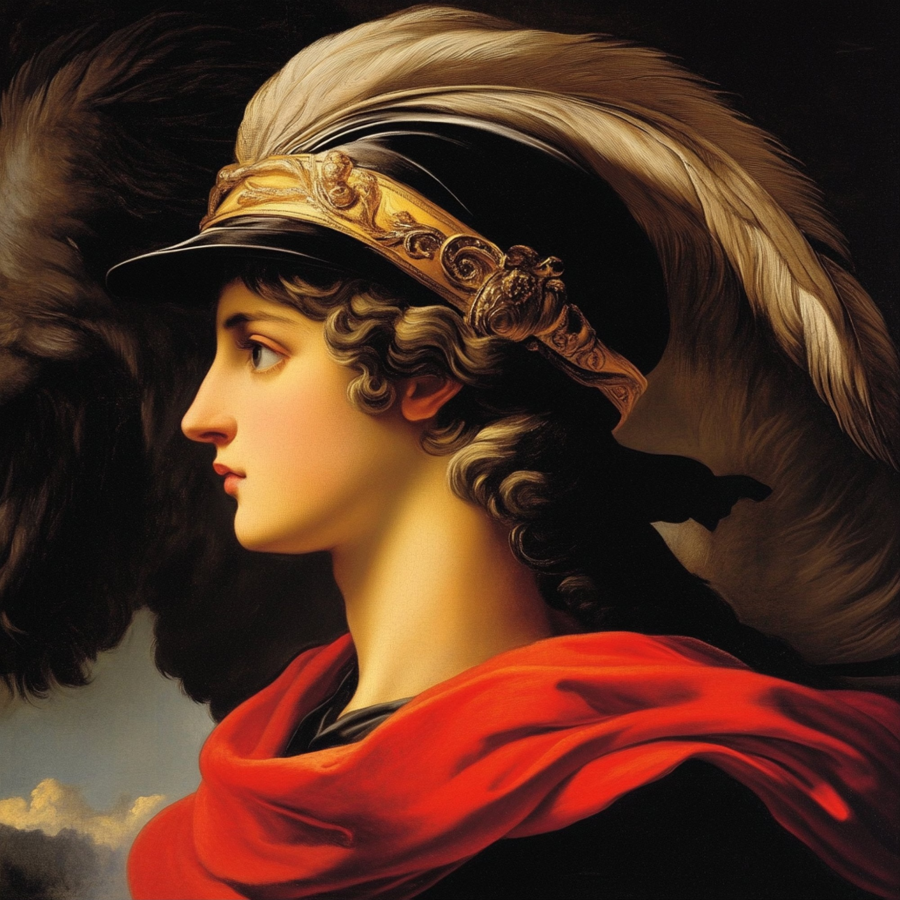
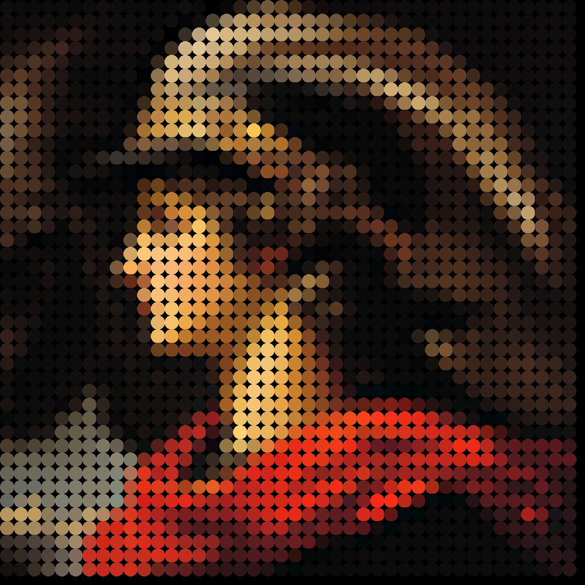

# cog-vectorized-dot-grid
Cog implementation of a Vectorized Dot Grid Image effect - workflow by Brett from Designjoy

This model takes an input image and applies a vectorized dot grid effect, transforming the image into a series of dots of varying sizes and colors, reminiscent of halftone printing but with a more modern, clean aesthetic.

## Setup

To get started with this model, you'll need to have [Cog](https://github.com/replicate/cog) installed.

1.  **Clone the repository:**
    ```bash
    git clone https://github.com/lucataco/cog-vectorized-dot-grid.git
    cd cog-vectorized-dot-grid
    ```

## Usage

You can run predictions using the `cog predict` command. Here's an example:

```bash
cog predict -i input_image=@path/to/your/image.png
```

This will output the processed image. You can find more options for the `cog predict` command in the [Cog documentation](https://github.com/replicate/cog/blob/main/docs/getting-started.md#run-predictions).

## Example

Here's an example of the vectorized dot grid effect:

| Input Image | Output Image |
| :---------: | :----------: |
|  |  |

## Model Details

*   **Input parameters:** Describe the expected inputs (e.g., image format, size constraints, any adjustable parameters for the dot grid effect).
*   **Output:** Describe the output format and characteristics.
*   **Underlying technology:** Briefly mention any key libraries or algorithms used (e.g., OpenCV, Pillow, specific vectorization techniques).

## Contributing

Contributions are welcome! Please feel free to submit a pull request or open an issue.

## License

The code in this repository is licensed under the [Apache License 2.0](LICENSE).
